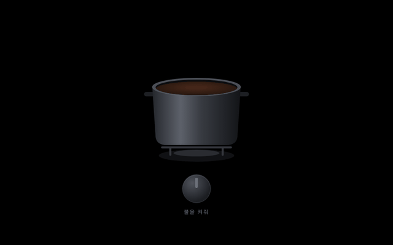
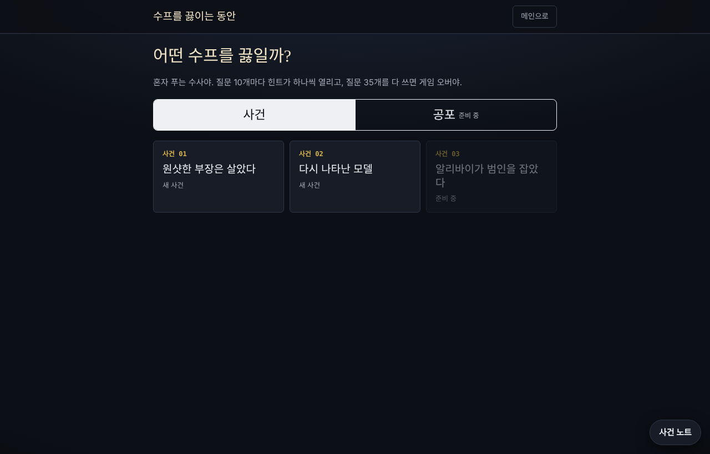
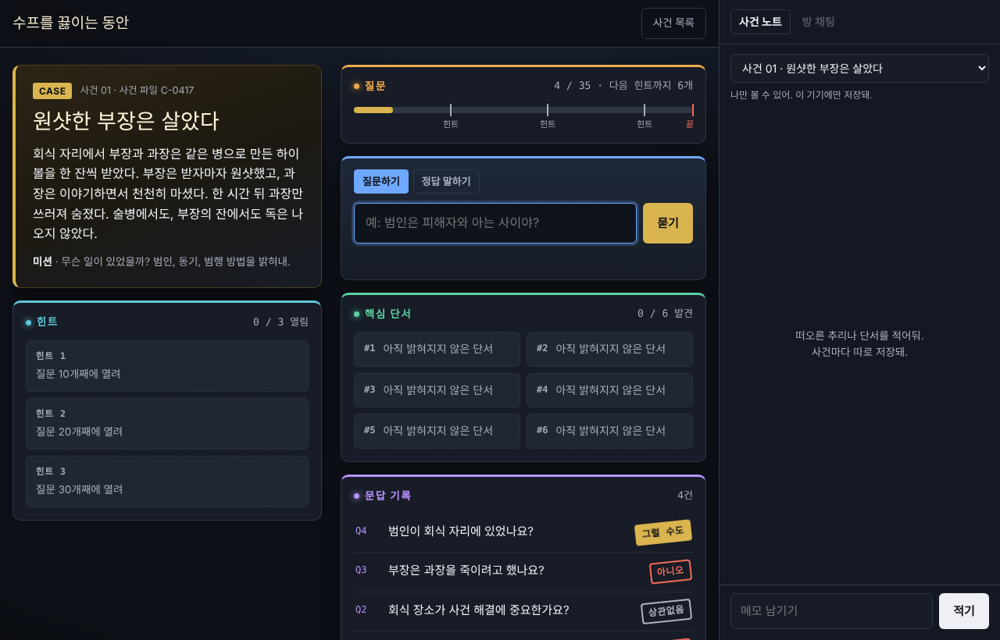
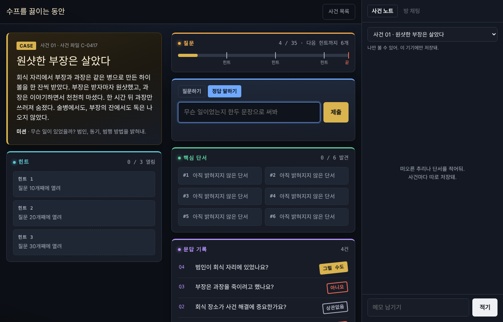
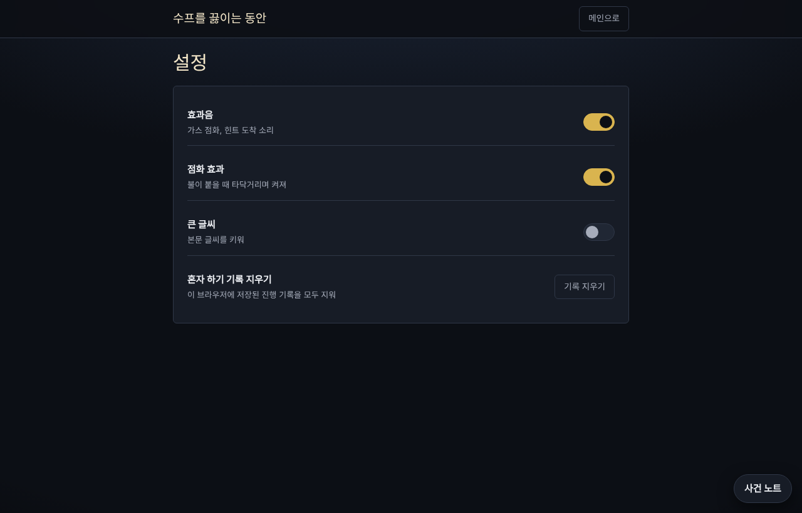
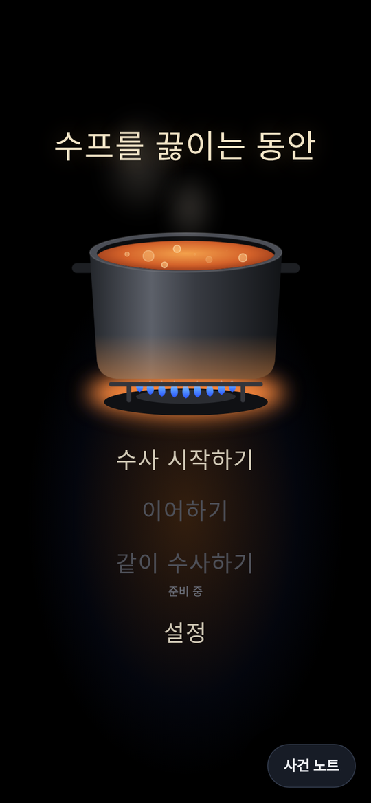
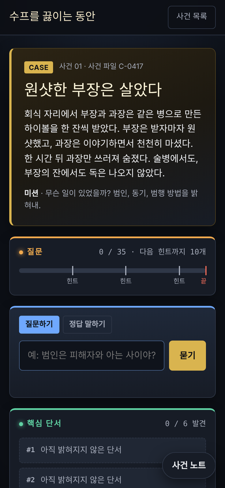
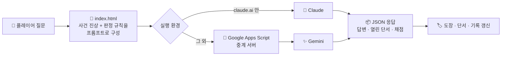

<div align="center">



<sub>🔥 불을 켜면 수프가 끓기 시작하고, 수사가 시작돼요.</sub>

<br/><br/>


<br/><br/>


</div>

<br/>

## 🍲 어떤 게임인가요?

> *"부장은 원샷했는데 살았고, 과장은 한 모금 마시고 쓰러졌다. 왜?"*

이상한 사건 하나가 주어지고, 플레이어는 **"예 / 아니오"로 답할 수 있는 질문만** 던져서 진상을 맞혀요.
흔히 **바다거북 수프**라고 부르는 추리 게임인데, 여기서는 사람 대신 **LLM이 사회자**를 맡아요.

사회자는 사건의 진상을 알고 있지만 절대 먼저 말해주지 않아요. 질문을 하나씩 판정하고, 중요한 단서에 닿으면 **핵심 단서**를 열어주고, 플레이어가 정답을 말하면 얼마나 가까운지 채점해요.

<br/>

## 🎮 플레이 화면

<table>
<tr>
<td width="50%" align="center"><b>① 수프 고르기</b></td>
<td width="50%" align="center"><b>② 질문하며 수사하기</b></td>
</tr>
<tr>
<td></td>
<td></td>
</tr>
<tr>
<td valign="top">장르와 사건을 고르면 바로 시작해요. 이어하기를 지원해서 하던 사건으로 돌아올 수 있어요.</td>
<td valign="top">질문을 던지면 사회자가 <b>도장</b>을 찍어 답해요. 오른쪽 <b>사건 노트</b>에는 내 추리를 따로 적어둘 수 있어요.</td>
</tr>
<tr>
<td width="50%" align="center"><b>③ 정답 말하기</b></td>
<td width="50%" align="center"><b>④ 설정</b></td>
</tr>
<tr>
<td></td>
<td></td>
</tr>
<tr>
<td valign="top">진상을 한두 문장으로 쓰면 <b>정답 / 거의 맞음 / 아직</b>으로 채점해요.</td>
<td valign="top">효과음, 점화 효과, 큰 글씨를 켜고 끌 수 있고, 저장된 기록도 지울 수 있어요.</td>
</tr>
</table>

<br/>

## 📜 규칙

| | |
|:-:|---|
| ❓ **질문 35개** | 예·아니오로 답할 수 있는 질문만 할 수 있어요. 35개를 다 쓰면 게임 오버. |
| 💡 **힌트 3개** | 질문 **10 · 20 · 30개**째에 하나씩 열려요. 미터에 체크포인트로 표시돼요. |
| 🔍 **핵심 단서 6칸** | 진상에 닿는 질문을 하면 단서 칸이 하나씩 채워져요. |
| 🏷️ **답변 도장** | 사회자는 아래 다섯 가지로만 답해요. |
| 🎯 **정답 말하기** | 언제든 진상을 제출할 수 있고, 정답·거의 맞음·아직으로 판정돼요. |

<div align="center">


<sub>"다시"는 예·아니오로 답할 수 없는 질문일 때 나와요.</sub>

</div>

<br/>

## 🗂️ 사건 목록

| 사건 | 제목 | 파일 번호 | 상태 |
|:-:|---|:-:|:-:|
| 01 | 원샷한 부장은 살았다 | C-0417 | ✅ |
| 02 | 다시 나타난 모델 | C-0904 | ✅ |
| 03 | 알리바이가 범인을 잡았다 | - | 🚧 준비 중 |
| 👻 | 공포 장르 | - | 🚧 준비 중 |

> 스포일러가 될 수 있어서 진상은 README에 적지 않았어요. 직접 끓여 보세요 🍲

<br/>

## 📱 모바일

<div align="center">

&nbsp;&nbsp;&nbsp;

</div>

<p align="center"><sub>휴대폰에서는 카드가 한 줄로 쌓이고, 사건 노트는 버튼으로 열어요.</sub></p>

<br/>

## ⚙️ 어떻게 동작하나요?



- **파일 하나로 끝**: 화면, 스타일, 게임 로직, 사건 데이터가 모두 `index.html` 하나에 들어 있어요. 빌드 없이 열면 바로 실행돼요.
- **구조화된 응답**: LLM이 자유롭게 말하지 않고 정해진 JSON(답변 종류, 열린 단서 번호 등)으로만 답하게 해서, 판정이 화면과 정확히 맞물려요.
- **기기 안 저장**: 진행 상황, 설정, 사건 노트는 브라우저 `localStorage`에만 저장돼요.

<br/>

## ✨ 특징

- 🔥 **점화 연출**: 손잡이를 돌리면 불이 붙고 수프가 끓으며 메뉴가 나타나요.
- 🏷️ **도장 애니메이션**: 답변이 도장처럼 쾅 찍혀서 문답 기록이 사건 파일처럼 쌓여요.
- 📝 **사건 노트**: 사건마다 따로 저장되는 개인 메모장.
- 💾 **이어하기**: 질문 기록과 열린 단서가 남아 있어서 언제든 돌아올 수 있어요.
- 🔤 **접근성**: 큰 글씨 모드, 효과음·점화 효과 끄기.
- 👥 **같이 수사하기 (준비 중)**: Firebase로 방을 만들어 친구와 함께 질문하는 모드를 준비하고 있어요. 방 채팅 UI는 이미 들어가 있어요.

<br/>

## 🚀 실행 방법

```bash
git clone https://github.com/Moomooti/Deduction-game.git
cd Deduction-game
# index.html을 브라우저로 열면 끝
```

> AI 사회자는 `index.html` 안의 `API_URL`(Apps Script 중계 주소)로 연결돼요. 내 Gemini 키로 돌리고 싶다면 Apps Script에 `{ prompt }`를 받아 `{ text }`로 돌려주는 웹 앱을 배포하고 주소를 바꿔주세요.

<br/>

## 📁 구조

```
Deduction-game/
├── index.html              # 게임 전체 (UI · 로직 · 사건 데이터 · AI 연동)
├── img/                    # 사건 장면 이미지
│   ├── c1-workbench.jpg
│   ├── c1-glasses.jpg
│   ├── c2-road.jpg
│   ├── c2-club.jpg
│   └── c2-mirror.jpg
└── docs/screenshots/       # README용 캡처
```

<br/>

## 🛠️ 개선 예정

- [ ] 사건 03 · 공포 장르 추가
- [ ] Firebase 연동으로 **같이 수사하기** 오픈
- [ ] 사건 진상을 서버 쪽으로 옮기기 (지금은 클라이언트 코드에서 볼 수 있어요)
- [ ] 중계 서버에 호출 제한 걸기


